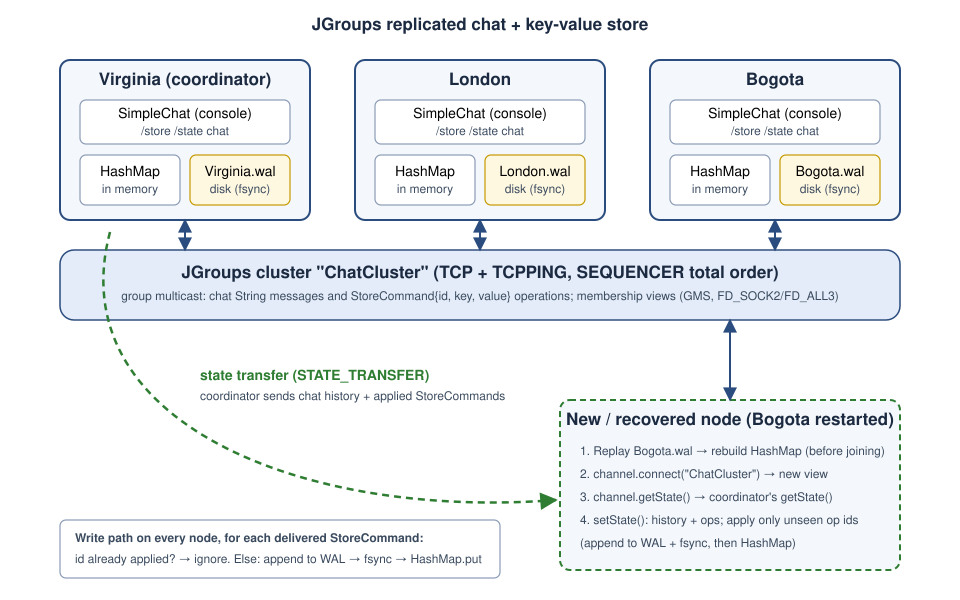
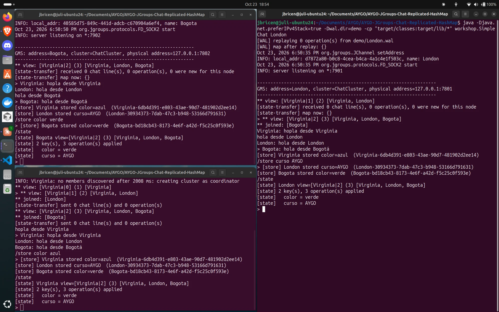
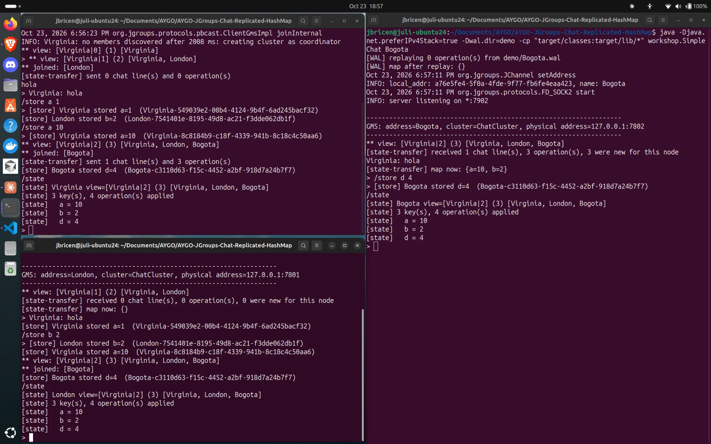
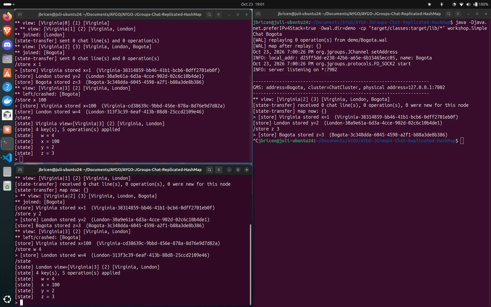
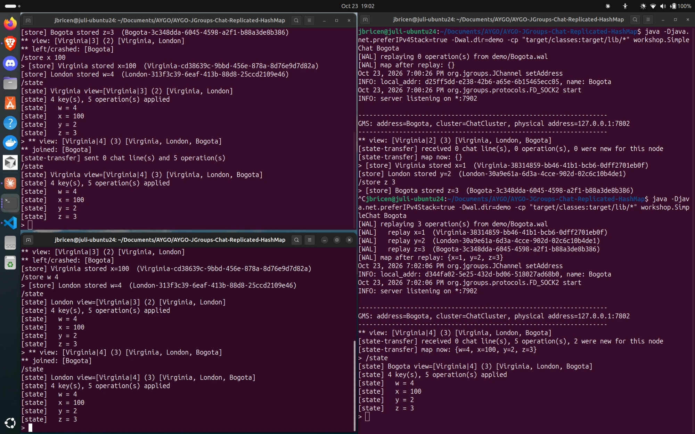

# JGroups Chat + Replicated HashMap (with Write-Ahead Log)

AYGO workshop: the JGroups tutorial console chat (`SimpleChat`) extended into a small replicated
key-value store. Every node keeps a local `HashMap<String, String>`; `/store` operations are multicast
to the group, written to a per-node write-ahead log (WAL) and then applied to memory. A node that
joins late — or restarts after a crash — replays its own WAL and then catches up through JGroups
state transfer.

```
src/main/java/workshop/
├── SimpleChat.java      # tutorial chat + /store, /state, WAL replay, state transfer, view changes
├── StoreCommand.java    # serializable record: id, key, value
└── WriteAheadLog.java   # append + fsync, read for replay
src/main/resources/
└── tcp-local.xml        # JGroups stack for several nodes on localhost
src/test/java/workshop/
└── WriteAheadLogTest.java  # JUnit tests: replay order, escaping, torn last record, malformed lines
run-experiments.sh       # runs the 4 required experiments unattended, writes evidence/
evidence/                # console logs and WAL files from the 4 experiments
docs/architecture.svg    # architecture diagram
docs/screenshots/        # screenshots of the four experiments
```

## Build and run

Requirements: Java 17+ and Maven.

```bash
mvn package            # compiles, runs the unit tests and copies jgroups.jar to target/lib
```

If Maven fails with `release version 17 not supported`, `JAVA_HOME` points to a JRE without
`javac`; point it to a JDK, e.g. `export JAVA_HOME=/usr/lib/jvm/<your-jdk>`.

Open three terminals in the project folder and start one node in each (the argument is the node
name and also the name of its WAL file):

```bash
java -Djava.net.preferIPv4Stack=true -cp "target/classes:target/lib/*" workshop.SimpleChat Virginia
java -Djava.net.preferIPv4Stack=true -cp "target/classes:target/lib/*" workshop.SimpleChat London
java -Djava.net.preferIPv4Stack=true -cp "target/classes:target/lib/*" workshop.SimpleChat Bogota
```

(On Windows use `;` instead of `:` in the classpath.)

Alternatively, run each node through Maven with the `exec-maven-plugin` (`-Dnode` sets the node
name, default `Virginia`):

```bash
mvn -q compile exec:java -Dnode=Virginia
mvn -q compile exec:java -Dnode=London
mvn -q compile exec:java -Dnode=Bogota
```

Each node writes `<Name>.wal` in the current
folder; use `-Dwal.dir=<folder>` to put WAL files elsewhere. Delete the `.wal` files to start from an
empty store.

| Input | Effect |
|---|---|
| `/store <key> <value>` | Stores or updates `key` in the replicated map (value may contain spaces) |
| `/state` | Prints this node's view and its local copy of the map |
| `/quit` | Leaves the cluster gracefully |
| anything else | Chat message to every participant |

To reproduce all four experiments automatically: `./run-experiments.sh` (Linux/macOS). It starts the
nodes in the background, feeds commands to them, kills one with `kill -9` to simulate a crash, and
saves every node's console to `evidence/<experiment>/<Node>.log`.

## Architecture



Each node is one JVM running `SimpleChat`, which is a JGroups `Receiver`:

- **Chat** (from the tutorial): a line typed in the console is sent as a `String` in an
  `ObjectMessage` with destination `null` (= the whole group). Every member, including the sender,
  prints it and appends it to the chat `history` list.
- **Replicated map**: `/store k v` creates a `StoreCommand(id, k, v)` and multicasts it the same
  way. The node does **not** update its map when the user types the command; it updates it when the
  operation comes back from the group, exactly like every other member. So all nodes take the same
  code path in the same order.
- **Local state per node**: `history`, the `HashMap`, the set of applied operation ids and the
  ordered list of applied operations (used for state transfer), all guarded by one lock.
- **WAL per node**: `Virginia.wal`, `London.wal`, `Bogota.wal`.

### How nodes discover and talk to each other

The stack is in `src/main/resources/tcp-local.xml` (based on JGroups' `tcp.xml`):

- **TCP** transport bound to `127.0.0.1`. The first node takes port 7800, the next 7801, etc.
- **TCPPING** discovery: a starting node sends a discovery request to `127.0.0.1:7800..7809`. If
  somebody answers, it asks the coordinator (the oldest member) to join; otherwise it becomes the
  coordinator of a new cluster. TCP was chosen over the tutorial's default UDP multicast because it
  works on any laptop/Wi-Fi without multicast routing.
- **GMS** manages membership and installs a new **view** (`[Coordinator|viewId] (size) [members]`)
  whenever someone joins, leaves or is suspected; `viewAccepted()` prints it with the joined /
  left-or-crashed members.
- **FD_SOCK2 / FD_ALL3 / VERIFY_SUSPECT2** detect crashed members (a killed process closes its
  socket, so the survivors notice in about a second).
- **NAKACK2 / UNICAST3** give reliable, FIFO delivery (retransmission of lost messages).
- **SEQUENCER** gives **total order**: every multicast is forwarded through the coordinator, which
  stamps a global sequence number, so every node delivers all operations in the same order. Without
  it, two concurrent `/store color ...` from different nodes could be applied in different orders and
  the replicas would disagree.
- **STATE_TRANSFER** implements `getState()` / `setState()`.

### How a `/store` is replicated

1. User types `/store color azul` on London.
2. London builds `StoreCommand{id="London-<uuid>", key="color", value="azul"}` and calls
   `channel.send(new ObjectMessage(null, cmd))`.
3. JGroups (SEQUENCER) delivers it to every member, London included, in the same global order.
4. Each member's `receive()` calls `apply(cmd)`:
   - if `cmd.id` is already in `appliedIds` → print "duplicate ignored" and stop;
   - append the operation to its WAL and `fsync`;
   - `map.put(key, value)`, remember the id, add it to the applied-operations list.
5. `/state` on any healthy member shows the same map.

### Write-ahead log

One UTF-8 text line per operation, tab separated:

```
STORE	Virginia-c7e7c122-4b97-4569-94a2-fbf43a53580e	x	1
STORE	London-0346dcc1-52a3-4bc1-b159-e97327a6e918	y	2
STORE	Virginia-de2fb883-d93d-4ebe-a5f8-75fee99da0f2	x	100
```

`STORE <opId> <key> <value>` (tabs, `\` and newlines inside a key or value are escaped). The file is
opened in append mode; `WriteAheadLog.append()` writes the line, flushes and calls
`FileDescriptor.sync()` so the record is on disk **before** `HashMap.put` runs. A crash in the
middle of a write can leave a last line without its `\n`; when the WAL is opened that torn record is
cut off (it was never applied, and the next record must start on a fresh line), and any other
malformed line is skipped on replay.

Role: the HashMap is only a cache that can always be rebuilt from the log. It is what lets a node
recover its data after a crash without asking anyone.

### WAL recovery + state transfer together

Startup order in `SimpleChat.start()`:

1. **Replay the WAL** (before joining): read every record, put it in the map, remember its id.
   This gives the node everything it had durably stored before it stopped.
2. **`channel.connect("ChatCluster")`**: join, new view on all members.
3. **`channel.getState(null, 10000)`**: the coordinator's `getState()` serialises the chat history
   and the ordered list of all applied `StoreCommand`s. In the joining node, `setState()` goes through
   that list and applies **only the ids it does not have yet** — through the same WAL-first path, so
   its WAL also becomes complete.

The WAL gives local durability (fast restart, survives even if the rest of the cluster is down);
state transfer gives the operations the node missed while it was away. Operation ids make the merge
safe: operations already replayed from the WAL are skipped. For a brand-new node step 1 is simply
empty and everything comes from state transfer. Messages sent while the state is being transferred
are handled by JGroups' STATE_TRANSFER/BARRIER, and any overlap is removed by the id check.

## Experiments (evidence in `evidence/`)

Each experiment has two kinds of evidence:

- **Log excerpts** from the unattended runs of `run-experiments.sh` (full logs and WAL files are in
  the `evidence/` folder; JGroups INFO lines omitted here).
- **Screenshots** of a manual run with three terminals side by side (`docs/screenshots/`). In every
  screenshot **Virginia is top-left, London is bottom-left and Bogota is on the right**; the WAL
  files of that run were written to a `demo/` folder (`-Dwal.dir=demo`).

### 1. Normal operation — `evidence/1-normal-operation/`

Three nodes, chat from each, `/store` from each (London overwrites `color`), `/state` everywhere:

```
** view: [Virginia|2] (3) [Virginia, London, Bogota]
Virginia: Hola desde Virginia
London: Hello from London
Bogota: Saludos desde Bogota
[store] Virginia stored color=azul
[store] London stored ciudad=Londres
[store] Bogota stored curso=AYGO
[store] London stored color=verde
[state] 3 key(s), 4 operation(s) applied
[state]   ciudad = Londres
[state]   color = verde
[state]   curso = AYGO
```

The same `/state` output appears in `Virginia.log`, `London.log` and `Bogota.log`.

**Screenshot** — manual run:



- All three nodes are in the same view `[Virginia|2] (3) [Virginia, London, Bogota]`; Virginia,
  the first one started, is the coordinator.
- Each node sends a chat message and every node prints all three (`Virginia: ...`,
  `London: ...`, `Bogota: ...`), so the original chat still works.
- `/store color azul` (Virginia), `/store curso AYGO` (London) and `/store color verde` (Bogota)
  appear as `[store] ... stored ...` lines in the **same order on all three nodes**, each with its
  unique operation id (`<node>-<uuid>`).
- `/state` gives the same result everywhere: `2 key(s), 3 operation(s) applied`,
  `color = verde`, `curso = AYGO` — Bogota's later update overwrote `color` on every replica.

### 2. Node join and state transfer — `evidence/2-join-state-transfer/`

Virginia and London store `a=1, b=2, c=3, a=10`; then Bogota starts:

```
# Virginia (coordinator)
** joined: [Bogota]
[state-transfer] sent 1 chat line(s) and 4 operation(s)

# Bogota
[WAL] replaying 0 operation(s) from .../Bogota.wal
** view: [Virginia|2] (3) [Virginia, London, Bogota]
[state-transfer] received 1 chat line(s), 4 operation(s), 4 were new for this node
[state-transfer] map now: {a=10, b=2, c=3}
[store] Bogota stored d=4          <- the new node participates in later updates
[state]   a = 10 / b = 2 / c = 3 / d = 4   (same on all three nodes)
```

**Screenshot** — manual run:



- Only Virginia and London are running at first: a chat message `hola` and the operations
  `a=1`, `b=2`, `a=10` are applied on both.
- Bogota (right) starts afterwards: `[WAL] replaying 0 operation(s)` shows it starts empty.
  Virginia prints `** joined: [Bogota]` and `[state-transfer] sent 1 chat line(s) and 3
  operation(s)`; Bogota prints `received 1 chat line(s), 3 operation(s), 3 were new for this
  node`, shows the chat history (`Virginia: hola`) and `map now: {a=10, b=2}`.
- Bogota then runs `/store d 4`; the operation reaches Virginia and London too, so the new node
  takes part in later updates.
- `/state` on the three nodes: `3 key(s), 4 operation(s) applied`, `a = 10`, `b = 2`, `d = 4`.

### 3. Node failure — `evidence/3-4-failure-and-recovery/`

Bogota is killed with `kill -9` after storing `x=1, y=2, z=3`. Survivors:

```
** view: [Virginia|3] (2) [Virginia, London]
** left/crashed: [Bogota]
[store] Virginia stored x=100
[store] London stored w=4
[state]   w = 4 / x = 100 / y = 2 / z = 3
```

**Screenshot** — manual run:



- With the three nodes up, `x=1` (Virginia), `y=2` (London) and `z=3` (Bogota) are stored on
  all of them.
- Bogota (right) is stopped with **Ctrl+C** (`^C` and the shell prompt): the process dies without
  leaving the group, like a crash.
- Virginia and London detect it and install a new view: `** view: [Virginia|3] (2) [Virginia,
  London]` and `** left/crashed: [Bogota]`.
- The two survivors keep working: `/store x 100` (Virginia) and `/store w 4` (London) are
  replicated between them, and `/state` shows `4 key(s), 5 operation(s) applied`, `w = 4`,
  `x = 100`, `y = 2`, `z = 3` on both.

### 4. Recovery from the WAL — `evidence/3-4-failure-and-recovery/Bogota-restart.log`

`Bogota.wal.before-restart` holds the 3 operations Bogota had stored before crashing. On restart:

```
[WAL] replaying 3 operation(s) from .../Bogota.wal
[WAL]   replay x=1 / y=2 / z=3
[WAL] map after replay: {x=1, y=2, z=3}
** view: [Virginia|4] (3) [Virginia, London, Bogota]
[state-transfer] received 0 chat line(s), 5 operation(s), 2 were new for this node
[state-transfer] map now: {w=4, x=100, y=2, z=3}
[store] Bogota stored v=5
[state]   v = 5 / w = 4 / x = 100 / y = 2 / z = 3   (same on all three nodes)
```

Only the 2 operations Bogota missed while down were applied (and appended to its WAL); the 3 it
already had were recognised by id and skipped. `wal/Bogota.wal` ends with all 6 operations.

**Screenshot** — manual run, continuing experiment 3 (same WAL files):



- Bogota (right) is started again with the same name, so it opens the same `demo/Bogota.wal`.
- **WAL replay before joining**: `[WAL] replaying 3 operation(s)` with `x=1`, `y=2`, `z=3`, and
  `map after replay: {x=1, y=2, z=3}` — the data Bogota had stored before the crash, recovered
  from its own disk. At this point `x` is still the old value `1`.
- **Rejoin**: the view on all nodes becomes `[Virginia|4] (3) [Virginia, London, Bogota]` and
  the others print `** joined: [Bogota]`.
- **State transfer**: Virginia `sent 0 chat line(s) and 5 operation(s)`; Bogota `received ...
  5 operation(s), 2 were new for this node` — the 3 operations already in its WAL are skipped by
  id and only `x=100` and `w=4` (missed while it was down) are applied. Result:
  `map now: {w=4, x=100, y=2, z=3}`.
- `/state` is identical on the three nodes: `4 key(s), 5 operation(s) applied`, `w = 4`,
  `x = 100`, `y = 2`, `z = 3`.

### Running the experiments by hand

1. Normal: start Virginia, London, Bogota; type messages; `/store` in each; `/state` in each.
2. Join: start only Virginia and London, do several `/store`; start Bogota; `/state` in Bogota.
3. Failure: with three nodes up, close one terminal (or `kill -9 <pid>` / Ctrl+C); watch the
   `** view` / `** left/crashed` lines in the others; keep doing `/store`.
4. Recovery: start the stopped node again with the same name (same `.wal` file); watch the
   `[WAL] replaying` lines, then the `[state-transfer] received ...` line; `/state` everywhere.

## Discussion questions

**Why must the WAL be written before the HashMap is updated?**
Memory is lost on a crash, disk is not. If the map were updated first and the node crashed before
logging, an operation that the node had already applied (and maybe shown in `/state`) would vanish
after restart. Writing and fsyncing the log first guarantees that everything that ever reached the
map can be rebuilt by replaying the log.

**What happens if a node crashes after writing the WAL but before updating its map?**
Nothing is lost: the map lives in memory and disappears anyway. On restart the node replays the
WAL and the operation is applied then. The log is the source of truth; the map is derived from it.
(If the crash happens in the middle of writing the line, the incomplete last line is cut off when
the WAL is reopened and the operation comes back through state transfer from the other nodes.)

**What happens if an operation is delivered more than once?**
Each `StoreCommand` has a unique id (`<origin>-<UUID>`). `apply()` checks `appliedIds` first and
ignores repeats, so it is neither logged twice nor applied twice. This is exactly what happens on
recovery: the operations a node already replayed from its WAL also arrive in the state transfer and
are skipped (experiment 4: "5 operation(s), 2 were new"). A `put` of the same value would be
idempotent anyway, but without ids a stale duplicate arriving after a newer value could overwrite it.

**What limitation remains if every node and every WAL file are lost?**
The data is gone. Replication protects against some nodes failing, and the WAL against process
crashes, but both copies live only on these machines. Durability beyond that needs storage outside
the group (backups/snapshots on another disk, another data centre). Related limits of this simple
design: the WAL and the applied-operations list grow forever (no compaction/snapshots), and if all
nodes crash and restart from WALs with different lengths there is no protocol to agree on the most
recent one — the first node to start becomes coordinator with whatever its WAL contains.

**How does state transfer help a new node become consistent with the group?**
A new node missed every message multicast before it joined. With `channel.getState()` the
coordinator sends it a consistent snapshot (chat history + ordered operations) taken at a precise
point in the message stream, and JGroups delivers to the new node only the messages sent after that
point. So snapshot + subsequent messages = exactly what the others have. For a recovered node the
snapshot fills only the gap since its crash, because the ids already in its WAL are skipped.

## AI-assisted development

I used an AI coding assistant (Claude) during the workshop, as the assignment encourages. Before
using it, I followed the JGroups tutorial by hand, typing each command, and ran the original chat
with several nodes to see how views, messages and state transfer behave.

**What the assistant generated.** I asked for the extension in small, focused steps rather than in
one request for the whole workshop. The assistant generated `StoreCommand`, `WriteAheadLog` and the
changes to the tutorial's `SimpleChat` (the `/store` and `/state` commands, `apply()` with the
WAL-first rule and id-based deduplication, the WAL replay at startup, the extended
`getState`/`setState` and the view-change output), as well as `tcp-local.xml`,
`run-experiments.sh`, the unit tests, the architecture diagram and the first draft of this README.
Using TCP + TCPPING instead of the tutorial's UDP multicast, and adding SEQUENCER for total order,
were the assistant's decisions, which I kept: multicast often does not work on a laptop or Wi-Fi,
and without total order two concurrent `/store` on the same key could leave replicas with different
values.

**Type of requests made.** The requests followed the steps of the assignment, for example: *"Add
`/store <key> <value>` and `/state` to the JGroups tutorial chat, keep the chat working"*, *"Design a
small serializable StoreCommand with a unique id"*, *"Implement an append-only WAL with one text
line per operation and fsync before applying"*, *"Replay the WAL at startup before connecting to the
cluster"*, *"Extend getState/setState so a joining node only applies missing operations"* and
*"Explain JGroups state transfer and membership views"*. Once the code was working I asked for a
review and a test pass of the whole project, asked whether the code followed good practices, asked
to be able to run the nodes with `mvn exec`, and asked to add the screenshots to this README with
an explanation of each one.

**What was reviewed, changed or simplified.** The design was kept to three small classes and plain
Java I/O, with no libraries beyond JGroups (JUnit is only used for tests). A node does not apply its
own `/store` before sending it; it waits for its own message to come back, so every node follows the
same code path. State transfer sends the ordered list of operations instead of the raw map, so a
recovered node applies only what it missed and its WAL stays complete. The review I requested found
a real bug: a WAL line torn by a crash during `append` was replayed with a truncated value, and the
next record was written on the same line. `WriteAheadLog` now cuts that torn tail off when it opens
the file, and a unit test covers it. The same review tightened the `/store` parsing and checked that
90 concurrent `/store` operations on one key from three nodes left the three WAL files byte-for-byte
identical. When I asked about good practices I chose to add JUnit tests for `WriteAheadLog` and to
turn `StoreCommand` into a Java `record`; the other points (Java serialization, no log compaction,
console output instead of a logger) stayed as documented trade-offs for a workshop.

**My part in testing it.** I ran the four experiments by hand in three terminals and took the
screenshots shown above. In my first attempt I started all three nodes with the same name, noticed
it in the view `[Virginia, Virginia, Virginia]` and restarted them with distinct names, since each
node must have its own WAL file. I also noticed that the architecture diagram was hard to read on
GitHub's dark theme and asked for a white background, and I organised the Git history into one
commit per logical step.

**My understanding of the code.** I can explain the design: why the WAL is written before the map,
how operation ids let WAL replay and state transfer be combined without applying anything twice,
how SEQUENCER keeps every replica in the same order, and what the four experiments show. I had not
used Java for a while, so I relied on the assistant for Java-specific details (records,
`FileChannel` and `fsync`, Java serialization) and checked them by running the tests and the
experiments.

**Why the design stays simple enough for the workshop.** One process per node, one text file per WAL, one lock, Java serialization for messages and state,
and JGroups' own protocols for discovery, failure detection, ordering and state transfer. There is
no consensus protocol, no log compaction and no persistence framework — those are the natural next
steps, and the discussion section explains where their absence shows.
